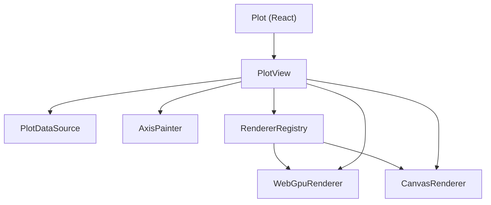

# Architecture

## Layers



- **`PlotDataSource`** supplies the shape and the data. It knows nothing about
  rendering.
- **`PlotView`** owns the DOM, the viewport, and the data request lifecycle. It
  is framework free.
- **`PlotRenderer`** draws series into a canvas. It knows nothing about where
  data came from.
- **`Plot`** is a thin React wrapper around `PlotView`.

The only thing that talks to both a source and a renderer is `PlotView`, which
keeps the two independently replaceable.

## DOM layout

`PlotView` builds two stacked canvases inside the container:

| Layer                             | Size           | Drawn by      |
| --------------------------------- | -------------- | ------------- |
| `canvas[data-dh-plot-layer=axes]` | Full container | `AxisPainter` |
| `canvas[data-dh-plot-layer=data]` | Plot area only | The renderer  |

The data canvas is positioned inside the theme margins and sized to exactly the
plot area. A renderer therefore maps the viewport onto its whole canvas and
never has to know about margins, clipping, or axis chrome. Because
`AxisPainter` is shared, every renderer produces identical axes, gridlines, and
legend.

The container carries two attributes that are useful for tests and debugging:

- `data-dh-plot-renderer` — the name of the resolved renderer
- `data-dh-plot-status` — `loading` while data requests are outstanding,
  `ready` otherwise

## Renderer selection

`RendererRegistry.resolve` walks the preference list in order and returns the
first factory that:

1. is registered,
2. declares support for every series type in the plot, and
3. reports `isSupported()` as true.

Support probes are asynchronous, because requesting a WebGPU adapter is, and
results are cached per renderer name. A renderer that throws during its probe is
treated as unsupported rather than failing the plot.

Registering a new renderer is the only thing needed to make it selectable:

```ts
import { defaultRendererRegistry } from '@deephaven/plot';

defaultRendererRegistry.register(mySvgRendererFactory);
```

## Data flow

There are two paths for getting data into a renderer.

**Pull**, on viewport or size change:

1. `PlotView.requestData` builds a `SeriesDataRequest` per series carrying the
   viewport, the plot area size in pixels, and the series style.
2. The source resolves `{ data, complete }`.
3. `PlotView` calls `renderer.setSeriesData` and marks the frame dirty.

Any request still in flight is aborted through an `AbortSignal`, and responses
from a superseded revision are discarded, so only the latest viewport wins.

**Push**, when the source signals a change:

1. The source emits `datachanged` with `SeriesDelta`s.
2. `PlotView` forwards a delta to the renderer only if the last result for that
   series was `complete`. Otherwise the renderer holds downsampled data whose
   indexes no longer line up with the source, so a fresh request is made
   instead.

## Rendering

`PlotView` never draws synchronously. Changes call `invalidate()`, which
schedules one `requestAnimationFrame`, so a burst of deltas or resize events
coalesces into a single frame.

## WebGPU renderer

Each series owns:

- a storage buffer of `vec2<f32>` positions,
- a uniform buffer holding the viewport, color, resolution, and size.

This layout is what makes incremental updates cheap:

- **Appending** writes only the new points at an offset with `writeBuffer`. No
  existing data is touched.
- **Panning and zooming** rewrite a 48 byte uniform. No point data moves at all.
- **Growth** doubles the buffer and re-uploads once, amortized across appends.

Positions are stored relative to a per series origin. An absolute `f32` loses
roughly two minutes of resolution on an epoch millisecond timestamp, which is
visible as jitter; storing offsets from an origin and shifting the viewport by
the same origin keeps values small. The origin is re-baselined whenever a series
is fully replaced.

Antialiasing is done in the fragment shader rather than with MSAA: points fade
out by distance from their center, and line segments by distance from their
centerline. That avoids a multisampled render target and gives smoother edges.
Segments are drawn as instanced quads extended by half the line width along
their direction, which closes the gap at joins without a separate join pass.

Renderers own their copy of series data. Sources are allowed to return their
internal arrays, so a renderer that applied a delta in place would corrupt the
source.

## Canvas renderer

Deliberately naive: every `render` redraws everything, and `applyDeltas` just
updates its copy. It exists so the package works everywhere, and as the
reference for what WebGPU output should look like.

## What is not here yet

Legends beyond a simple swatch row, tooltips and hover, non-linear axes, series
types beyond scatter and line, and a Deephaven backed data source.
